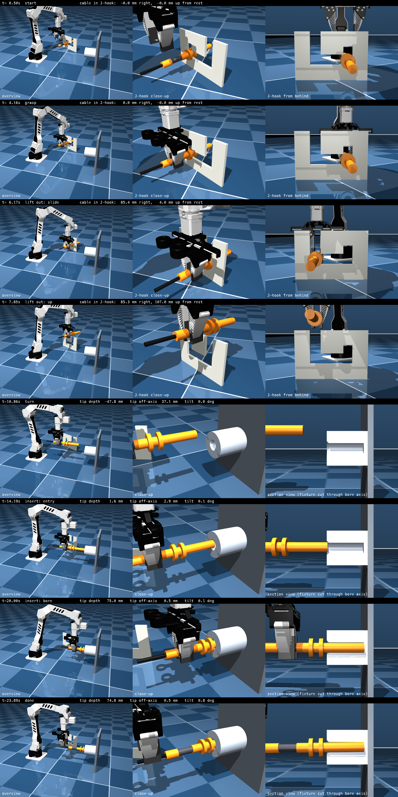

# Panthera-HT peg-in-hole (MuJoCo)

A Panthera-HT 6-DOF arm picks a cable housing out of a J-hook, swings round,
and plugs it into a horizontally mounted blind hole: Ø21 mm, 75 mm deep,
0.5 mm radial clearance, with a 45° × 4 mm chamfer at the opening. The
housing is the grip adapter on the end of a long cable.

The housing starts resting in a J-shaped slot in a vertical plate off to the
robot's left. Its neck sits on the floor of the slot, with a flange on either
side of the plate. The cable comes out of the back, so the arm grabs the
housing from the side. The gripper comes straight down onto a grip groove and
closes across it. The arm then lifts the housing out along the J: up off the
floor of the slot, sideways to the stem, then up the stem until the flanges
clear the top. Next it turns to face the hole. The arm is aimed about 3.4 mm
off the hole axis on purpose, and the chamfer guides the plug in.



## Run

```bash
uv venv --python 3.12 .venv && uv pip install --python .venv/bin/python -r requirements.txt
```

```bash
.venv/bin/python peg_in_hole/build_scene.py
```

```bash
.venv/bin/python peg_in_hole/run_insertion.py
```

Outputs land in `peg_in_hole/out/`: `peg_in_hole.mp4`, `storyboard.png`,
`insertion_plot.png` and `log.csv`. The video has an overview panel plus two
detail panels. At the hook these are a close-up and a view from behind the
plate. After the turn they become a close-up of the hole and a section view
cut through the bore axis.

Options: `--offset DY DZ` (sideways/vertical aiming error in metres, default
`0.003 0.002`), `--speed` (insertion speed, m/s), `--start hand` (skip the
J-hook and start already holding the housing), `--no-video`, and `--viewer`
for a live window (on macOS run it with `.venv/bin/mjpython`). The housing
shape, the hook geometry and placement, the start poses, the grasp point and
the hole location are set in `Params` in `build_scene.py`.

Control experiment without a chamfer (same aiming error):

```bash
.venv/bin/python peg_in_hole/build_scene.py --chamfer 0 --out peg_in_hole/scene_nochamfer.xml
```

```bash
.venv/bin/python peg_in_hole/run_insertion.py --scene peg_in_hole/scene_nochamfer.xml --tag _nochamfer
```

## What's in here

| Path | What |
| --- | --- |
| `third_party/Panthera-HT_SDK/` | Sparse checkout of HighTorque's official SDK: only the V1.1.0 MuJoCo model and URDF are used |
| `peg_in_hole/build_scene.py` | Builds `scene.xml` from the official model with MjSpec |
| `peg_in_hole/kinematics.py` | Quaternion helpers and damped-least-squares IK (used for the start keyframes) |
| `peg_in_hole/run_insertion.py` | Controller, task sequence, metrics, video and plots |

### Scene (`build_scene.py`)
- **Robot**: the SDK's `Panthera-HT_description_V1.1.0/mujoco/scene.xml`
  (joint torque motors, URDF effort limits). The SDK model welds the gripper
  shut, so the fingers are made prismatic (0–41 mm each, right finger
  mimic-coupled to the left), following the SDK's `urdf/README.md`. The finger
  mesh hulls are swapped for friction pads (32 mm wide). Grip force is capped
  at 25 N.
- **Side-grasp TCP**: the TCP sits between the pads, 17 mm in from the
  fingertips. TCP x runs along the gripped housing toward the plug, and TCP
  z points back up the gripper. With the identity orientation the gripper
  points straight down and the housing lies along world +x.
- **Cable housing**: aluminium, 199 mm long and 193 g, built from coaxial
  cylinders. From the tip back:
  - a Ø20 × 82 mm plug: 75 mm goes into the bore, leaving 7 mm before the
    flange;
  - two Ø38 × 8 mm flanges with a Ø20 × 12 mm neck between them;
  - a Ø20 shaft;
  - a Ø16 × 36 mm grip groove (the dark band) for the 32 mm pads;
  - the rear end, with a short cable stub that is visual only.

  The section lengths put the centre of mass in the middle of the neck, so
  the housing rests level in the hook.
- **J-hook**: an 8 mm vertical plate, 60° to the robot's left, with a J slot
  made of five boxes. The channel and stem are 28 mm wide, which leaves 4 mm
  of clearance on each side of the neck. The tip of the J rises 22 mm on the
  left. The stem is 85 mm to the right and runs 60 mm up to the open top.
  The neck rests on the channel floor at 0.05 m height, perpendicular to the
  plate, with the flanges 2 mm off either face. They overlap the plate
  around the slot, so the housing can only leave along the J. Sites in the
  plate mark the neck-centre waypoints out of the J.
- **Start states**: the `hook` keyframe (default) has the housing resting in
  the J-hook. The arm starts back from and above the groove, with the
  fingers open and pointing down. The housing's rest pose is found by
  letting it settle into the slot during the build. The `ready` keyframe
  (`--start hand`) has the arm (solved with IK) already holding the housing
  by its groove.
- **Hole**: the bore axis is horizontal, with the opening facing the robot,
  at (0.41, 0, 0.12) m. It sits in a boss on a vertical mounting plate.
  MuJoCo only collides convex shapes, so the bore wall is 48 convex annular
  sectors. Each sector's r–z profile is a rectangle with the chamfer cutting
  off one corner, so it stays convex. The flat faces sit exactly at the
  nominal bore radius.
- **Layout and reach**: with the gripper pointing straight down, the arm
  runs out of wrist pitch (joint 4, ±90°) above about z = 0.17 m. Its reach
  also ends about 0.43 m from the base. That is why the hole is low and
  close, and why the hook is low with a short stem: the top of the lift-out
  stays within reach.
- **No-slip friction** (`noslip_iterations=3`). Without it, MuJoCo's
  soft-contact friction lets the overhanging housing slowly rotate in the
  grasp under its own weight.

### Control (`run_insertion.py`)
- **Cartesian impedance control** at 1 kHz:
  `τ = Jᵀ[K(x_d − x) + D(v_d − v)] + bias + b·q̇ + J_comᵀ·m_peg·g`.
  - The bias term is MuJoCo's gravity plus Coriolis compensation.
  - `b·q̇` cancels 90% of the model's 1 N·m·s/rad joint damping. Without it,
    the wrist lags its setpoint by up to 3° during large joint motions.
  - The last term is feed-forward for the carried housing. Its centre of
    mass is 57 mm ahead of the grasp point.
  - `K` and `D` are defined in the TCP frame: axial along the housing,
    lateral across it.
- **Free motion**: minimum-jerk Cartesian moves at 1500 N/m and 40 N·m/rad,
  with the compliance centre at the TCP. Before the grasp and before
  insertion, the arm holds until the error has stayed below 0.05 mm and
  0.05° for 0.15 s. Checking only once can pass at a zero crossing of a
  slow residual swing, and the insertion would then start with the arm
  still moving.
- **Pick from the hook**: the housing's pose comes from the scene. The arm
  lines up 60 mm above the grip groove and comes straight down. The open
  fingers sit 29 mm from centre, well clear of the Ø20 shaft and the Ø38
  flanges. Then they close across the groove. The groove's shoulders locate
  the housing along its axis to within ±2 mm. The feed-forward for the
  housing switches on, and the arm steps through the hook's waypoints:
  4 mm up to the middle of the channel, 85 mm right to the stem, then up
  until the flanges are 10 mm above the plate.
- **Turn**: the TCP swings round the base axis to the hole, interpolating
  yaw, radius and height rather than moving in a straight line. The tool
  turns with it, so this is mostly joint 1. The swing stays at the exit
  height, clear of the plate, and the arm comes down in front of the hole
  once it gets there.
- **Insertion**: the compliance centre moves to the plug tip, 153 mm ahead
  of the grasp, like a passive remote-centre-compliance (RCC) device.
  Lateral stiffness drops to 250 N/m, axial is 900 N/m, and rotation stays
  stiff. The setpoint advances along the bore axis at 15 mm/s, slowing to
  5 mm/s for the last 5 mm. When the plug's rim lands on the chamfer, the
  axial push becomes a sideways push that slides the tip onto the axis
  without tilting the housing. Inside the bore, the lateral setpoint drifts
  toward the measured position to remove side load. The arm stops pushing
  about 3 mm past the floor (a few newtons of preload). It then unloads,
  opens the fingers, lifts 30 mm and backs away.
- **Jam guard**: if the setpoint gets more than 12 mm ahead of the tip before
  the tip enters the hole (about 11 N of push), the arm aborts and backs off.

## Results

Default run (housing starts in the J-hook; aim offset 3 mm sideways, 2 mm up):

| Metric | Value |
| --- | --- |
| Housing contact with the hook while lifting it out | none (flanges included) |
| Smallest neck–slot clearance during the lift-out | 2.3 mm, next to the tip of the J (3.6 mm in the stem) |
| Robot or finger contact with the hook or fixture | none |
| Lift-out time / whole task | 3.7 s / 23.9 s |
| In-hand offset after the grasp | 0.26 mm sideways, 0.22 mm along the housing |
| Tip offset from the bore axis at pre-insert | 3.45 mm (3.3–3.5 mm until contact) |
| Insertion depth | 74.8 / 75.0 mm, seated against the floor |
| Final tip offset | 0.50 mm: lying on the bottom of the bore under gravity (clearance is 0.5 mm) |
| Housing tilt during insertion / after release | < 0.2° / 0.8° |
| Peak plug–fixture contact force | 3.3 N |
| Insertion time | 6.5 s |
| Smallest joint-limit margin during the run | 0.11 rad (joint 4, at the top of the lift-out and in the turn) |

The tilt after release is real, not an error. Most of the housing hangs
outside the bore, so once the fingers let go it settles within the
clearance: 2 × 0.5 mm over 75 mm is about 0.76°.

The left panel of `insertion_plot.png` traces the neck centre through the J
slot, with the flanges overlapping the plate. The other panels show the
tip's off-axis error falling to the 0.5 mm clearance exactly across the
4 mm chamfer zone. **Without the chamfer**, the same aim lands the plug on
the flat face around the hole, the jam guard trips at 11.6 N, and the arm
backs off with the housing still held (`storyboard_nochamfer.png`).

`--start hand` gives the same insertion results (3.42 mm at pre-insert,
74.8 mm deep, 0.50 mm final offset, 4.5 N peak).

Capture range: I swept aiming errors over 8 directions, starting from the
hook. Every direction succeeded up to 4.0 mm, 4 of 8 at 4.5 mm and none at
5.0 mm. `--start hand` also succeeded everywhere up to 4.0 mm, then 5 of 8
at 4.5 mm and none at 5.0 mm. The geometric limit is 4.5 mm (chamfer plus
clearance), so at 4.5 mm the outcome depends on direction. The failures are
the directions where the in-hand offset and the drift before contact add to
the aiming error instead of cancelling it.

## Caveats
- The housing is rigid, and only a short visual stub of the cable is
  modelled. A real cable would drape out of the back and pull on the
  housing. It would need MuJoCo's cable/flex elements and probably a
  different grasp point.
- Poses are known: the housing's pose in the hook and the hole location come
  from the scene, not from perception. The only errors are the deliberate
  aiming offset and the real in-hand offset that comes out of the physical
  grasp.
- The grip groove fixes the housing along its axis. Without it, the old
  plain rod crept about 0.75 mm through the fingers while being carried.
  Here it moves 0.22 mm, and the shoulders cap it at 2 mm.
- The layout is fitted to this arm's top-down reach. The hole is low and
  close, the hook sits low with a 60 mm stem, and the tightest joint margin
  is 0.11 rad. Moving the hole or hook out or up quickly runs joint 4 into
  its limit.
- Contact parameters (friction 0.3 housing–fixture, 1.5 at the finger pads,
  stiff `solref`) are reasonable but not identified from hardware.
- The bore is a 48-gon. Its flats sit at the nominal radius, and its corners
  are 0.02 mm further out.
